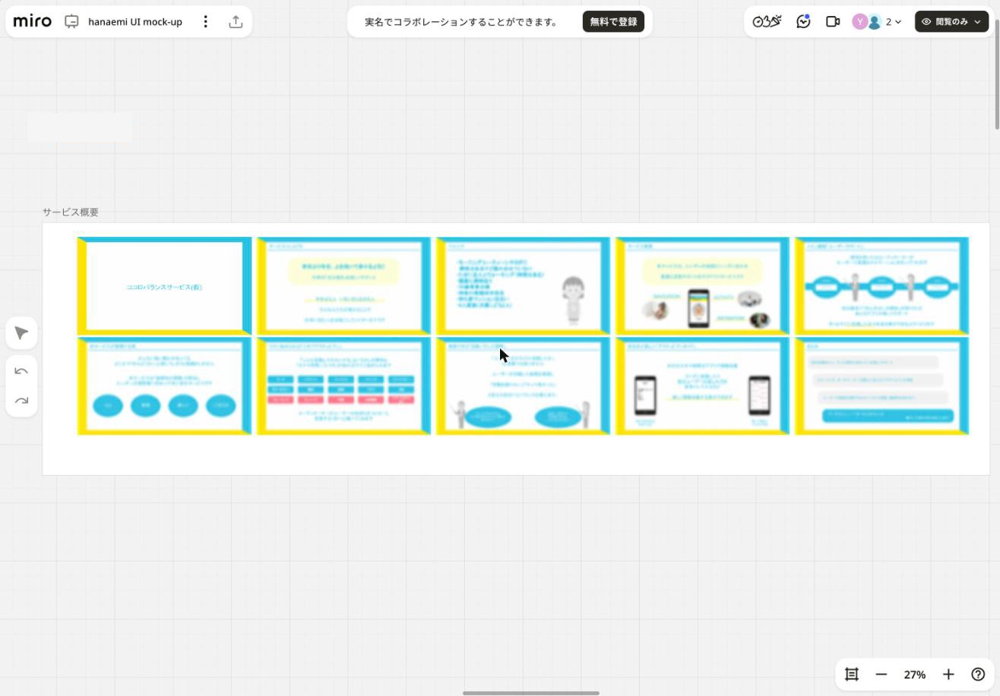

# 01. サービス概要

## プロダクト

- 名称: **hanaemi（はなゑみ / はなえみ）**。企画初期の仮称は「ココロバランスサービス(仮)」
- 形態: スマートフォンアプリ（縦画面前提。iPhone SE サイズの画面も作成予定）
- キャッチ: 「はなゑみ ウェルビーイングの世界へようこそ」（本登録完了画面の文言）

## コンセプト（サービス概要スライドより）

- **昨日より今日、上を向いて歩けるように**。日常の「自分磨き」を楽しくサポートする
- 「今幸せな人」「いきいきと生きる人」を増やし、日本に住む人を元気にする
- ユーザーの多様なニーズに合わせて、最適な活動をサポートする。3つの柱は次のとおり
  - **NAVIGATION**: 個性を持った AI コーディネーター（＝トレーナー / キャラクター）が最適なナビゲーションを行う。朝・夕方（ブレイクタイム）・夜にプログラムを提案
  - **ACTIVITY**: 「スキマ時間」と「スマホ」があればすぐ始められる活動（ヨガ、瞑想、日記、ストレッチなど）
  - **INFORMATION**: 自分の状態の可視化と記録
- 重視すること: 「めんどくさい」と感じると続かない。**継続性の課題**を解決する
  - キーワード: **ラク / 実感 / 楽しい / ごほうび**
- 活動バランス調整: どれだけ活動したかより、活動の結果を実感し「続けたい」「やって良かった」と思える状態に導く
- 将来構想（スライド）: クイズ、他ユーザーの楽しみ方を見る TALK BOARD などの「アクティビティガイド」

## ターゲット

- **30〜40代女性**
- 家族持ち（子どもが小学生くらいで手が離れつつある）
- 仕事より家事の比重が大きく、平日に自分の時間が取りやすい
- スライドのペルソナ: 39 歳の専業主婦、横浜市在住、持ち家マンション、4 人家族。モーニングルーティーンやヨガに興味はあるが踏み出せていない。健康に関心がある

### ターゲット像に関する議論メモ

- 共通点は「見た目を気にする」「自分を知りたい」という欲求。ログから発見があることを喜ぶ
- 感覚に頼りがちなので、**数値で分かると楽しい**
- 日本市場では「マイナスをゼロにする」思考（不安の解消）が刺さる。心を健康にする価値を提供する
- 想定ユーザー像: ①30代後半の独身女性（仕事と家の往復、自分磨きを始めるタイミング）、②40代前半の主婦（子どもの手が離れ、自分の時間ができた）

## ユーザーインタビューの要点

ボードには 3 名分のインタビュー記録がある（匿名化し、属性はおおまかに記載している）。

| | ユーザーA | ユーザーB | ユーザーC |
|---|---|---|---|
| 属性 | 40代、会社員 | 40代、既婚・子あり、フリーランス | 30代、既婚・子あり、経営者 |
| 自分の時間 | △ 週末 | ◎ 平日の朝〜15時 | × 朝4〜6時のみ |
| 傾向 | ストイック、失敗を恐れる、マイペースなレコメンドを好む。強めのコーチングは苦手 | マイペースでゆるく続けたい。手帳派。天気予報が1日の最初のタッチポイント | ルーティーン重視、頑張りすぎない。「誰が言っているか」を重視 |
| 示唆 | **記録と可視化**が大事。手軽さ、ストレスなく続けられること | **ジャーナリング**に関心。自分に近い人の活動を見たい | ロールモデルを示し、それを真似するスタイルが合う |

### 機能への反映

- 起動するだけで記録が進む、入力の負担が少ない設計（「入力するのって大変！」）
- 体重・生理などの日々の記録と可視化
- 対話してくれる相手（声優のボイスを持つコーチングキャラクター）。ナビキャラは OFF も可能にする
- 利用シーンは朝と夜。「朝の時間をよくする」
- 天気予報や手帳と連動する発想がヒント（→「今日の状態」を天気で表すUIにつながる）
