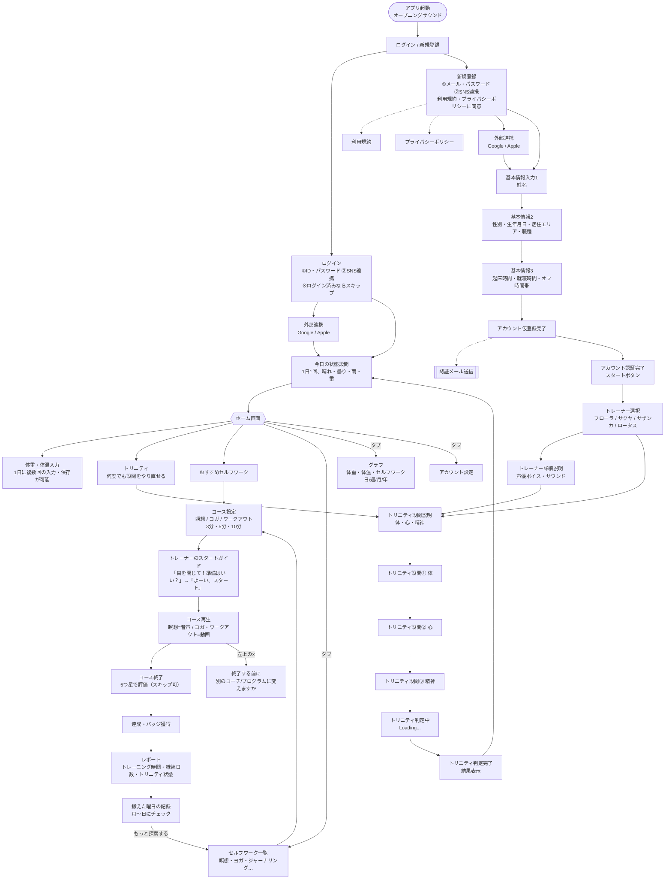
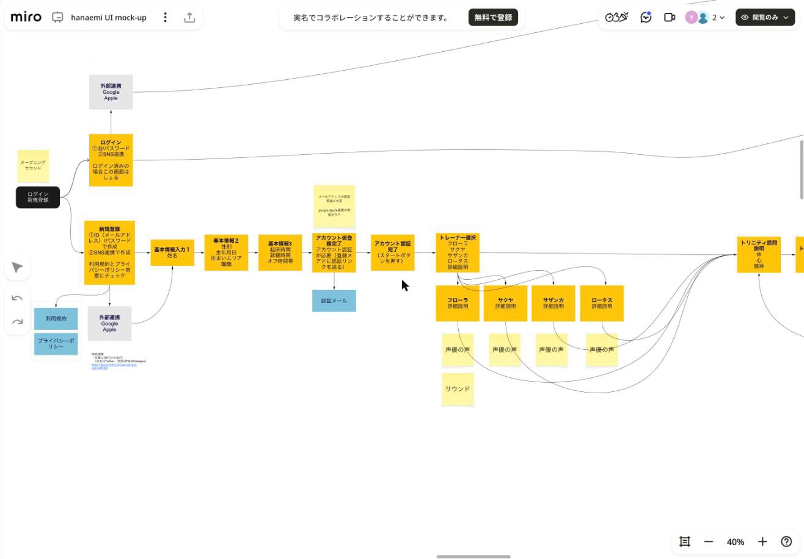
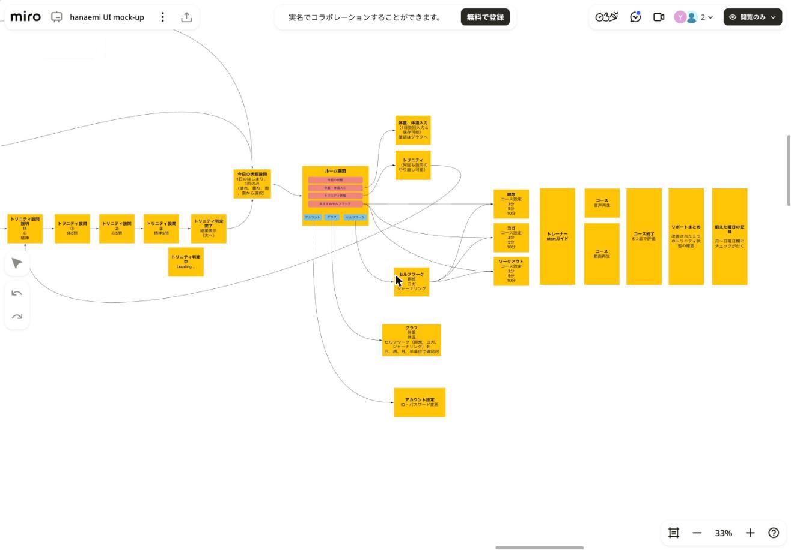
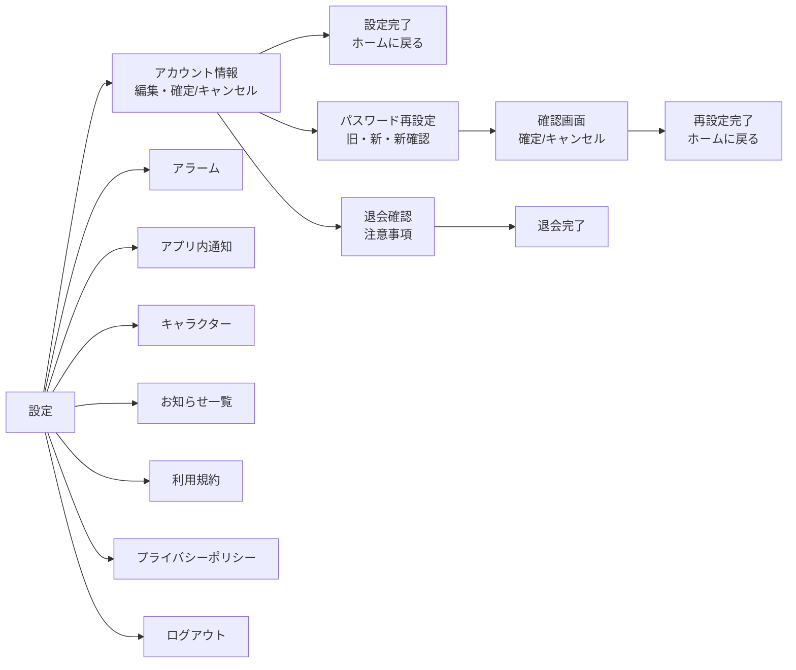
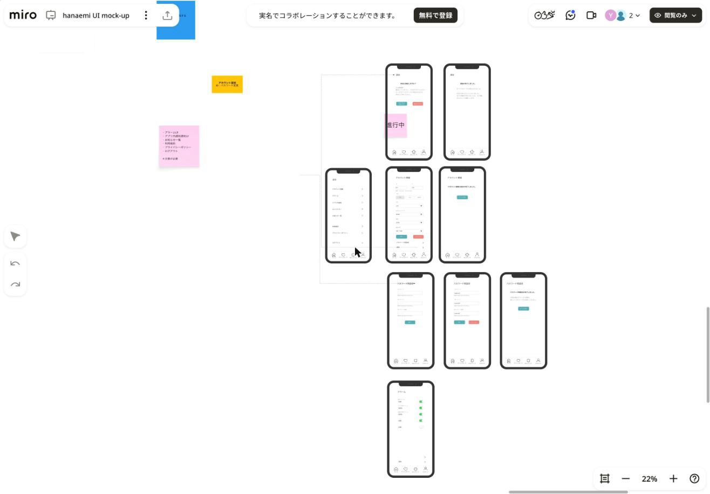
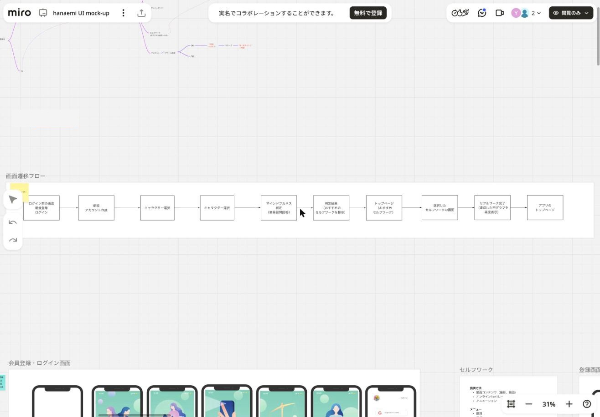
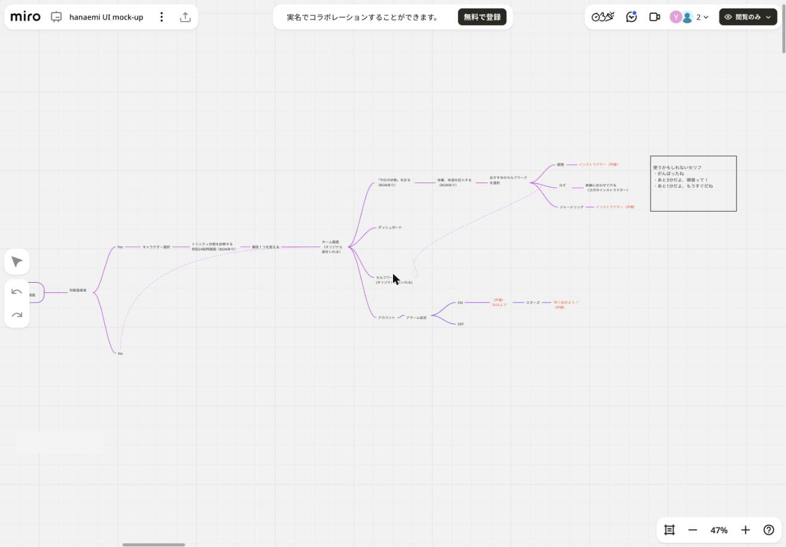

# 02. 画面遷移

## 2.1 最新フロー（UI画面整理（開発向け））

ボードのコネクタ（矢印）の接続関係から起こした遷移図。



- ボード上では「アカウント認証完了 → トレーナー選択 → トリニティ設問説明」の後ろに、デザインカンプとして「回答説明（体）」「回答説明（心・精神）」「今日の状態へのつなぎ設問」が挟まっている（[03_screens.md](03_screens.md) 参照）
- 「今日の状態設問」は、**翌日 0 時を過ぎてから初めてアプリを起動したとき**に表示する（付箋より）




## 2.2 ボトムタブ

最新カンプのタブは次の 4 つ。

| タブ | 遷移先 |
|---|---|
| ホーム | ホーム画面 |
| ダッシュボード（＝グラフ） | グラフ画面 |
| セルフワーク | セルフワーク一覧 |
| アカウント | 設定画面 |

> ワイヤーフレームではタブ名が「ダッシュボード」と「グラフ」の 2 通りある。フロー図では「グラフ」、カンプのタブラベルでは「ダッシュボード」になっている（[07_open-issues.md](07_open-issues.md)）。

## 2.3 アカウント設定配下





## 2.4 初期案の画面遷移フロー（参考）

ボード左上の「画面遷移フロー」フレーム。

```
ログイン前の画面（新規登録 / ログイン）→ 新規アカウント作成 → キャラクター選択 → キャラクター選択
→ マインドフルネス判定（簡易設問回答）→ 判定結果（おすすめのセルフワークを提示）
→ トップページ（おすすめセルフワーク）→ 選択したセルフワークの画面
→ セルフワーク完了（達成した円グラフを再度表示）→ アプリのトップページ
```



## 2.5 初期のサイトマップ（マインドマップ）

```
ログイン画面
└ 初期登録者？
   ├ Yes → キャラクター選択 → トリニティ状態を診断する初回24設問画面（BGMあり）→ 最低1つを答える → ホーム画面
   └ No ─────────────────────────────────────────────→ ホーム画面
ホーム画面（オリジナル曲を流す）
├ 「今日の状態」を計る（BGMあり）→ 体重・体温を記入する（BGMあり）→ おすすめのセルフワークを選択
│     ├ 瞑想 ─ インストラクター（声優）
│     ├ ヨガ ─ 映像に合わせて行う（ヨガのインストラクター）
│     └ ジャーナリング ─ インストラクター（声優）
├ ダッシュボード
├ セルフワーク（オリジナル曲を流す）
└ アカウント ─ アラーム設定
      ├ ON → （声優）"おはよう" → スヌーズ → "早く起きよう！"（声優）
      └ OFF
```


