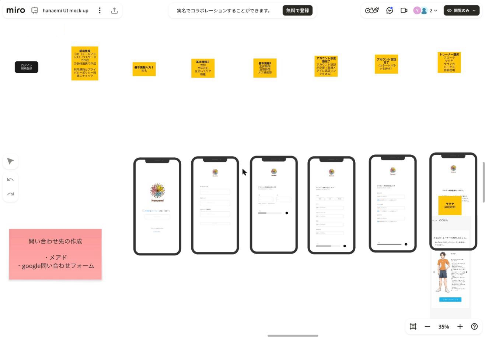
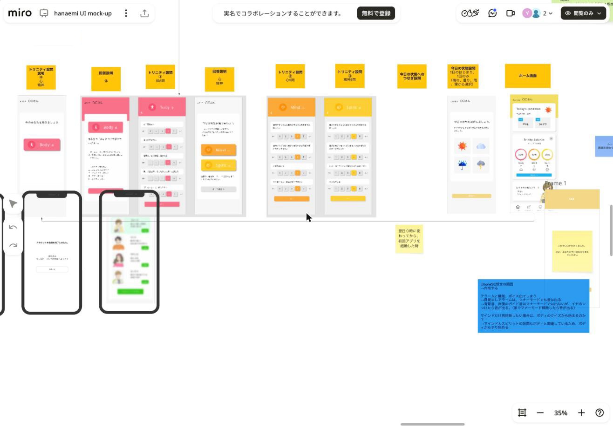
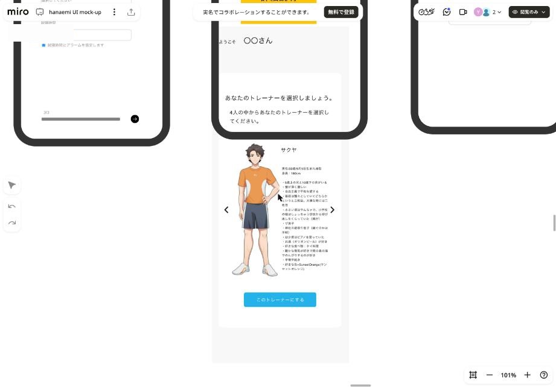
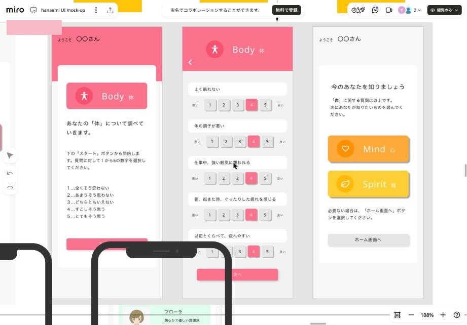
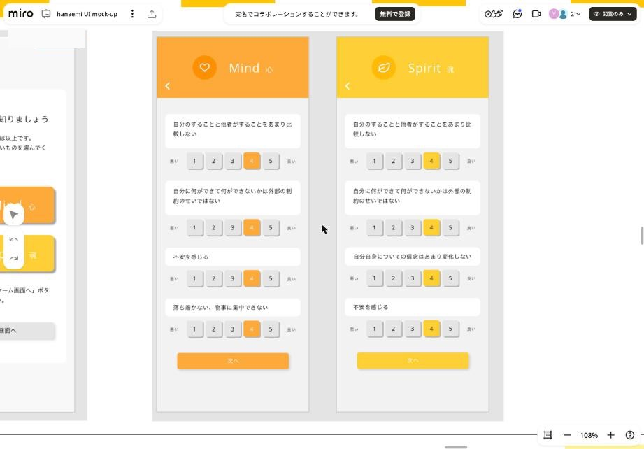
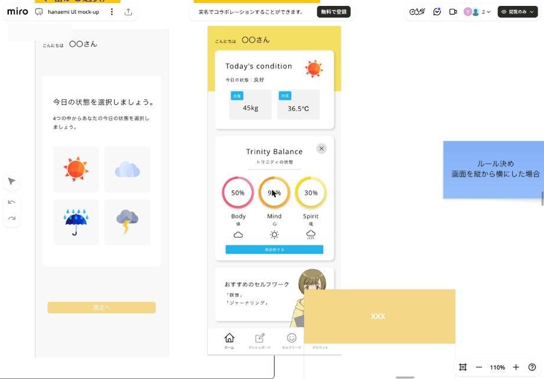
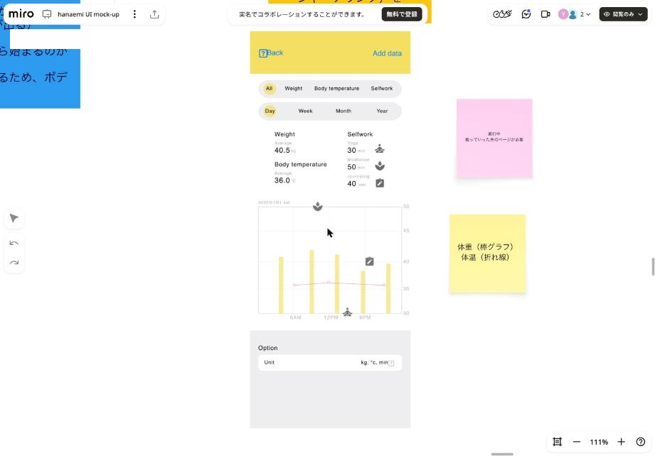
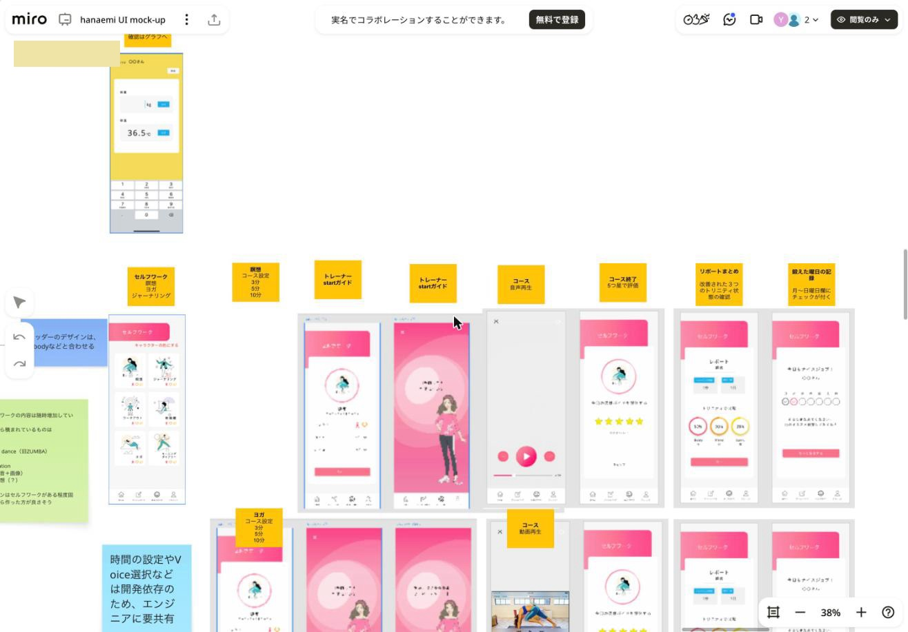
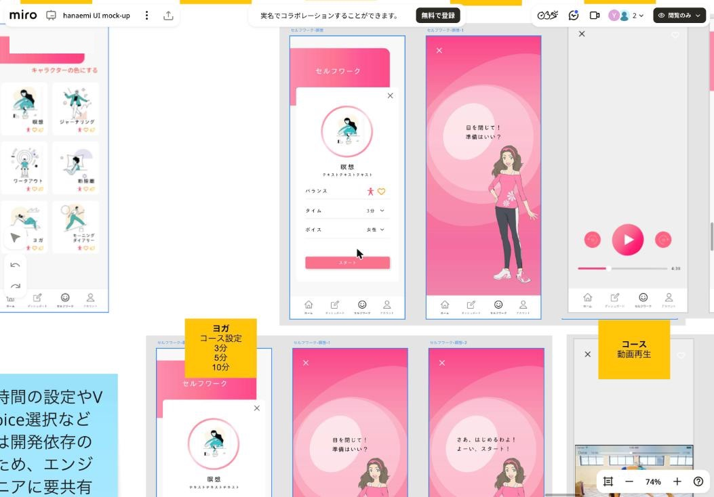
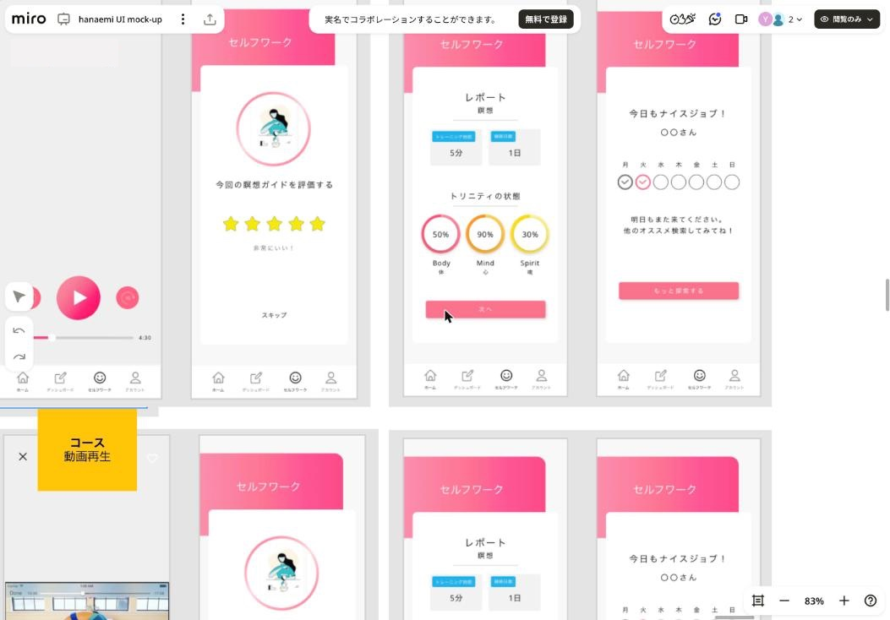

# 03. 画面一覧

画面 ID は本ドキュメントで便宜的に振ったもの。「出典」は根拠にしたボード上の要素を指す（開発向け＝UI画面整理（開発向け）フレーム、WF＝初期ワイヤーフレーム）。

## 一覧

| ID | 画面 | 区分 | 出典 |
|---|---|---|---|
| A-01 | スプラッシュ / オープニング | 共通 | 開発向け付箋、WF付箋 |
| A-02 | スタートガイド（最大5枚） | 共通 | WF付箋 |
| A-03 | ログイン / 新規登録の選択（トップ） | 認証 | 開発向け、WF |
| A-04 | ログイン | 認証 | 開発向け、WF |
| A-05 | 新規登録（メール・パスワード） | 認証 | 開発向け、WF |
| A-06 | 基本情報入力 1/3（姓名） | 認証 | 開発向け、WF |
| A-07 | 基本情報入力 2/3（属性） | 認証 | 開発向け、WF |
| A-08 | 基本情報入力 3/3（生活時間とアラーム） | 認証 | 開発向け、WF |
| A-09 | アカウント仮登録完了 | 認証 | 開発向け、WF |
| A-10 | アカウント本登録完了 | 認証 | 開発向け、WF |
| O-01 | トレーナー選択 | 初期設定 | 開発向け |
| O-02 | トレーナー詳細 | 初期設定 | 開発向け |
| O-03 | トリニティ設問説明 | 初期設定 | 開発向け |
| O-04 | 回答説明（体） | 初期設定 | 開発向け |
| O-05 | トリニティ設問①（体） | 初期設定 | 開発向け |
| O-06 | 回答説明（心・精神の選択） | 初期設定 | 開発向け |
| O-07 | トリニティ設問②（心） | 初期設定 | 開発向け |
| O-08 | トリニティ設問③（精神） | 初期設定 | 開発向け |
| O-09 | トリニティ判定中 | 初期設定 | 開発向け |
| O-10 | トリニティ判定完了（結果表示） | 初期設定 | 開発向け、WF |
| O-11 | 今日の状態へのつなぎ | 初期設定 | 開発向け |
| D-01 | 今日の状態設問 | 毎日 | 開発向け |
| H-01 | ホーム | メイン | 開発向け |
| H-02 | 体重・体温入力 | メイン | 開発向け |
| G-01 | グラフ（ダッシュボード） | メイン | 開発向け |
| S-01 | セルフワーク一覧 | セルフワーク | 開発向け |
| S-02 | コース設定 | セルフワーク | 開発向け、WF |
| S-03 | スタートガイド 1（準備） | セルフワーク | 開発向け、WF |
| S-04 | スタートガイド 2（スタート） | セルフワーク | 開発向け、WF |
| S-05 | 再生（音声 / 動画） | セルフワーク | 開発向け、WF |
| S-06 | 中断確認ダイアログ | セルフワーク | WF |
| S-07 | 評価 | セルフワーク | 開発向け、WF |
| S-08 | 達成・バッジ獲得 | セルフワーク | WF |
| S-09 | レポート | セルフワーク | 開発向け、WF |
| S-10 | 週の記録（ナイスジョブ） | セルフワーク | 開発向け、WF |
| U-01 | 設定トップ | アカウント | 開発向け |
| U-02 | アカウント情報編集 | アカウント | 開発向け |
| U-03 | アカウント情報 設定完了 | アカウント | 開発向け |
| U-04 | パスワード再設定 入力 | アカウント | 開発向け |
| U-05 | パスワード再設定 確認 | アカウント | 開発向け |
| U-06 | パスワード再設定 完了 | アカウント | 開発向け |
| U-07 | アラーム設定 | アカウント | 開発向け |
| U-08 | 退会確認 | アカウント | 開発向け |
| U-09 | 退会完了 | アカウント | 開発向け |
| U-10 | アプリ内通知 / お知らせ一覧 / 利用規約 / プライバシーポリシー | アカウント | 開発向け付箋（UI未作成） |

---

## 認証・登録

### A-01 スプラッシュ / オープニング
- オープニングサウンドを鳴らす
- ひまわり（ロゴの花）が広がっていくアニメーション（付箋案）

### A-02 スタートガイド
- 最大 5 枚。イラストは外部に依頼する想定（WF付箋）

### A-03 ログイン / 新規登録の選択
- hanaemi のロゴ
- チェックボックス「利用規約&プライバシーに同意して登録する」
- ボタン「新規登録する」
- 「アカウントお持ちの方」→ リンク「ログインする」

### A-04 ログイン
- ①ID（メール）とパスワード、②SNS 連携
- SNS ボタン: 最新は **Google / Apple**（WF では Google / Facebook）
- ログイン済みの場合、この画面は表示しない

### A-05 新規登録
- メールアドレス
- パスワード（英数 8 文字以上）
- パスワード（確認用）
- ボタン「新規登録」
- SNS 連携（Google / Apple）で作成した場合も、基本情報入力 1 に進む

### A-06 基本情報入力 1/3
- 見出し「アカウント情報を設定します」「お名前を入力してください。」
- 姓 / 名（プレースホルダ: 田中 / 太郎）。注記「漢字・ひらがな・カタカナのみ」
- 進捗バーと次へボタン

### A-07 基本情報入力 2/3
- 性別: 男性 / 女性 / 無回答（ボタンで選択）
- 年代（フロー図では「生年月日」）: セレクト
- お住まいのエリア: セレクト
- 職種: セレクト
- 婚姻状態: セレクト（WF・カンプにあり。フロー図にはない）

### A-08 基本情報入力 3/3
- 起床時間 / オフの時間 / 就寝時間: それぞれセレクト
- 各項目にチェックボックス「〇〇時間にアラームを設定します」

### A-09 アカウント仮登録完了
- 「アカウント仮登録をしました。」
- 「ご登録したメールアドレスに届いた『hanaemi本登録のご案内』メールにて、アカウントの本登録を完了してください。」
- 登録メールアドレスへ認証リンクを送る

### A-10 アカウント本登録完了
- 「アカウント本登録を完了しました。」「はなゑみ ウェルビーイングの世界へようこそ」
- ボタン「スタート」

---

## 初期設定（トレーナー選択・トリニティ診断）

### O-01 トレーナー選択 / O-02 トレーナー詳細
- 「あなたのトレーナーを選択しましょう。4人の中からあなたのトレーナーを選択してください。」
- 左右の矢印で 4 人を切り替えるカルーセル。立ち絵とプロフィールを表示
- ボタン「このトレーナーにする」
- 詳細画面では声優ボイスとサウンドを再生する
- 別案（過去カンプ）: 4 人を一覧表示し、それぞれに「詳細」ボタンを付ける形

### O-03 トリニティ設問説明
- 「今のあなたを知りましょう」
- Body（体）ボタン

### O-04 回答説明（体）
- 「あなたの『体』について調べていきます」
- 下の「スタート」ボタンから開始する。各質問に 1〜5 の数字で回答する
- 1: 全くそう思わない / 2: あまりそう思わない / 3: どちらともいえない / 4: すこしそう思う / 5: とてもそう思う

### O-05 トリニティ設問①（体）
ヘッダーは Body（ピンク）。各設問に 1〜5 のボタン（左端「悪い」、右端「良い」）と「次へ」。
1. よく眠れない
2. 体の調子が悪い
3. 仕事中、強い眠気に襲われる
4. 朝、起きた時、ぐったりした疲れを感じる
5. 以前とくらべて、疲れやすい

### O-06 回答説明（心・精神の選択）
- 「『体』に関する質問は以上です。次にあなたが知りたいものを選んでください。」
- ボタン: Mind（心）/ Spirit（魂）
- 「必要ない場合は『ホーム画面へ』ボタンを選択してください。」→ ボタン「ホーム画面へ」

### O-07 トリニティ設問②（心）
ヘッダーは Mind（オレンジ）。
1. 自分のすることと他者がすることをあまり比較しない
2. 自分に何ができて何ができないかは外部の制約のせいではない
3. 不安を感じる
4. 落ち着かない、物事に集中できない

### O-08 トリニティ設問③（精神 / Spirit）
ヘッダーは Spirit（黄色）。
1. 自分のすることと他者がすることをあまり比較しない
2. 自分に何ができて何ができないかは外部の制約のせいではない
3. 自分自身についての信念はあまり変化しない
4. 不安を感じる

> 設問数はフロー図では各 5 問、カンプでは体 5・心 4・精神 4 問。設問文は仮のもの（心と精神で重複あり）と思われる（[07_open-issues.md](07_open-issues.md)）。

### O-09 トリニティ判定中
- Loading 表示

### O-10 トリニティ判定完了
- WF の文言: 「あなたの今の状態は〇〇ですね。心 〇〇 / 体 〇〇 / 魂 〇〇」
- 「次へ」で今日の状態設問へ

### O-11 今日の状態へのつなぎ
- 「これで〇〇がわかりました。次に、あなたの今日の気分を教えてください」→「次へ」

---

## 毎日の入力とホーム

### D-01 今日の状態設問
- 「こんにちは 〇〇さん」
- 「今日の状態を選択しましょう。4つの中からあなたの今日の状態を選択しましょう。」
- 2×2 のアイコン選択: 晴れ / 曇り / 雨 / 雷
- ボタン「測定へ」
- 1 日 1 回、その日最初の起動時（翌日 0 時を過ぎてから初めて起動したとき）にポップアップ表示する

### H-01 ホーム
- 挨拶「こんにちは 〇〇さん」
- **Today's condition** カード
  - 今日の状態（天気アイコンと「良好」などのラベル）
  - 体重（例: 45kg）、体温（例: 36.5℃）
- **Trinity Balance（トリニティの状態）** カード
  - Body / Mind / Spirit の 3 つの円グラフ（％表示、例: 50% / 90% / 30%）
  - 各項目の下に天気アイコン
  - ボタン「再診断する」
  - 右上の × で閉じられる（非表示にできる）
- **おすすめのセルフワーク** カード
  - 例: 「瞑想」「ジャーナリング」。選択したトレーナーのイラストを添える
- ボトムタブ: ホーム / ダッシュボード / セルフワーク / アカウント
- 過去案の補足: 今日の状態・体重・体温・生理周期の 4 項目は表示・非表示を切り替えられる。曇りが何日も続くとアラートを出す

### H-02 体重・体温入力
- 日時表示（例: 7月22日 9:00）と「保存」ボタン
- 体重（kg）、体温（℃）。テンキー入力
- 1 日に複数回入力・保存できる（ログとして残す）。確認はグラフで行う
- WF には「生理 Start / End」ボタンがあるが、後の付箋に「生理周期をなくす」とある

### G-01 グラフ（ダッシュボード）
- ヘッダー: Back / Add data
- 種別フィルタ: All / Weight / Body temperature / Selfwork
- 期間: Day / Week / Month / Year
- サマリ: Weight 平均、Body temperature 平均、Selfwork の種類別合計時間（Yoga / Meditation / Journaling）
- グラフ: 体重は棒グラフ、体温は折れ線。セルフワークを実施した時刻にアイコンを重ねる
- Option: Unit（kg, ℃, min）
- 付箋「進行中。掘っていった先のページが必要」→ 詳細画面は未作成

---

## セルフワーク

### S-01 セルフワーク一覧
- 見出し「セルフワーク」
- 2 列グリッドのカード: 瞑想 / ジャーナリング / ワークアウト / 断捨離 / ヨガ / モーニングダイアリー
- 各カードにイラストと、効果のある領域のアイコン（体・心・魂）
- 付箋「キャラクターの色にする」（選んだトレーナーのテーマカラーに合わせる）

### S-02 コース設定（モーダル）
- 円形のイラスト、タイトル（例: 瞑想）、説明文
- バランス: 効果のある領域のアイコン（体・心・魂）
- タイム: 3分 / 5分 / 10分（セレクト）
- ボイス: 女性 など（セレクト。瞑想のみ）
- ヨガ・ワークアウトは「ゴール」「プログラム」を選ぶ案もある（WF）
- ボタン「スタート」、右上の × で閉じる

### S-03 / S-04 スタートガイド
- トレーナーの立ち絵と吹き出し
  - 瞑想: 「目を閉じて！準備はいい？」→「さあ、はじめるよ！よーい、スタート！」
  - ヨガ: 「深呼吸して！準備はいい？」→ 同上
  - ワークアウト: 「体をリラックスして！準備はいい？」→ 同上
- 背景はピンクの同心円

### S-05 再生
- 瞑想: 音声再生。プレイボタン、前後スキップ、シークバーと残り時間（例: 4:30）
  - 背景は白。インストラクターの声に合わせて hanaemi のロゴが動く（付箋）
- ヨガ / ワークアウト: 動画再生。動画を全画面にするボタンを付ける（付箋）
- 左上の × で中断する
- 応援のセリフ案: 「がんばったね」「あと3分だよ、頑張って！」「あと1分だよ、もうすぐだね」「あと◎秒」「次は**だよ」

### S-06 中断確認ダイアログ
- 「終了する前に」
- 瞑想: 「男性コーチに変えますか」/ ヨガ: 「他のヨガプログラムに変えますか」/ ワークアウト: 「他のワークアウトのコースに変えますか」
- はい / いいえ

### S-07 評価
- 「今回の瞑想ガイドを評価する」（ヨガ / ワークアウトも同様）
- 5 段階の星。選んだ数に応じてラベルを出す（例: 非常に良い！/ 良い！/ 普通）
- 「スキップ」

### S-08 達成・バッジ獲得
- 「ご達成おめでとうございます！」
- バッジ（例: シングルスター、ダブルスター）と「バッジ獲得」
- 「次へ」

### S-09 レポート
- 「レポート」と種目名
- トレーニング時間（例: 5分）、継続日数（例: 1日）
- トリニティの状態: 心・体・魂のビフォー / アフター（円グラフ）
- 付箋「トリニティ状態にどのくらい効果があったかパーセンテージで示す」
- 「次へ」

### S-10 週の記録
- 「今日もナイスジョブ！〇〇さん」
- 月〜日のチェック欄（実施した曜日にチェック）
- 「明日もまた来てください。他のオススメも探索してみてね！」
- ボタン「もっと探索する」

---

## アカウント

### U-01 設定トップ
- アカウント情報 / アラーム / アプリ内通知 / キャラクター / お知らせ一覧 / 利用規約 / プライバシーポリシー / ログアウト
- 過去案にあった項目: プラン変更 / 支払い管理 / クーポン / サービス退会（課金関連は最新版では消えている）

### U-02 アカウント情報編集
- 姓・名、性別、年代、お住まいのエリア、職種、婚姻状態（登録時と同じ項目）
- 確定 / キャンセル
- リンク: パスワード再設定 / 退会

### U-03 設定完了
- 「アカウント情報の設定が完了しました。」→「ホームに戻る」

### U-04〜U-06 パスワード再設定
- 旧パスワード / 新パスワード / 新パスワード確認（英数字の組み合わせ 8 文字以上）
- 「確認へ」→ 確認画面で「確定 / キャンセル」→ 完了画面「パスワード再設定が完了しました。次回以降ログインする際は、新しいパスワードをお使いください。」→「ホームに戻る」

### U-07 アラーム設定
- 起床アラーム（例: 4:00）、オフの時間アラーム（例: 18:00）、就寝の時間アラーム（例: 23:00）。それぞれトグル
- 任意の時刻のアラームを追加できる（例: 4:20, 5:20）
- 付箋「アラーム設定を追加する。UX 設計が必要」

### U-08 退会確認
- 「本当に退会しますか？」
- 注意事項「退会してしまうと、これまでのウェルビーイングすべてのデータが消去されます。予めご了承ください。」
- 「上記了承の上退会します」/「退会をやめます」

### U-09 退会完了
- 「退会が完了しました。すべてのデータが消去されました。今までありがとうございました。またの機会がありましたら、その際はよろしくお願いします。」

### U-10 未作成の画面（付箋より）
- アラーム UI、アプリ内通知 UI、お知らせ一覧、利用規約、プライバシーポリシー、ログアウト（「文章が必要」）
- 問い合わせ先（メールアドレス、または Google フォーム）
