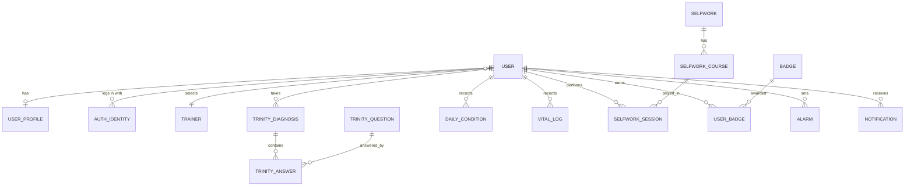

# 05. データモデル案

ボードの画面と仕様から推定した、論理データモデルのたたき台。ボード上にデータ定義はないため、すべて提案扱いとする。

## エンティティ

### USER / USER_PROFILE
| カラム | 型 | 備考 |
|---|---|---|
| id | uuid | |
| email | string | メール登録の場合 |
| password_hash | string | 英数 8 文字以上 |
| email_verified_at | datetime | 本登録の完了日時。NULL なら仮登録 |
| last_name / first_name | string | 漢字・ひらがな・カタカナのみ |
| gender | enum(male, female, unspecified) | |
| age_group or birth_date | enum / date | 未確定（[07_open-issues.md](07_open-issues.md)） |
| area | string | 都道府県 |
| occupation | enum | 選択肢は未定 |
| marital_status | enum | 選択肢は未定 |
| wake_time / off_time / bed_time | time | |
| trainer_id | fk | |
| created_at / deleted_at | datetime | 退会時は全データ削除 |

### AUTH_IDENTITY
| カラム | 型 | 備考 |
|---|---|---|
| user_id | fk | |
| provider | enum(email, google, apple) | |
| provider_uid | string | |

### TRAINER（マスタ）
| カラム | 型 | 備考 |
|---|---|---|
| id | | flora / sakuya / sazanka / lotus |
| name, gender, profile | | プロフィール文 |
| theme_color | | キャラクターのテーマカラー |
| voice_assets | | ガイド、応援、アラームのボイス |
| unlock_condition | | （案）早起き回数による解放 |

### TRINITY_QUESTION（マスタ）
| カラム | 型 | 備考 |
|---|---|---|
| id | | |
| domain | enum(body, mind, spirit) | |
| text | string | |
| reverse_scored | bool | 「よく眠れない」のように否定形の設問を反転するかどうか（要定義） |
| order | int | |

### TRINITY_DIAGNOSIS / TRINITY_ANSWER
| カラム | 型 | 備考 |
|---|---|---|
| diagnosis.id, user_id, taken_at | | 再診断のたびにレコードを作る |
| body_score / mind_score / spirit_score | int (0-100) | 未回答の領域は NULL |
| answer.question_id, value | int (1-5) | |

> 「現在のトリニティ％」は、最新の診断結果にセルフワークによる改善分を足したものになる想定。算出ロジックは未定。

### DAILY_CONDITION（今日の状態）
| カラム | 型 | 備考 |
|---|---|---|
| user_id, date | | 1 日 1 件（unique） |
| weather | enum(sunny, cloudy, rainy, thunder) | （案）係数 1 / 0.75 / 0.5 / 0.25 |
| recorded_at | datetime | |

### VITAL_LOG（体重・体温）
| カラム | 型 | 備考 |
|---|---|---|
| user_id, recorded_at | | 1 日に複数件可 |
| weight_kg | decimal(4,1) | |
| body_temp_c | decimal(3,1) | |
| （未確定）menstruation_start / end | date | 生理周期の扱いは未定 |

### SELFWORK / SELFWORK_COURSE（マスタ）
| カラム | 型 | 備考 |
|---|---|---|
| selfwork.id | | meditation / yoga / journaling / morning_diary / danshari / workout |
| selfwork.effect_domains | set(body, mind, spirit) | 例: 瞑想 = mind, spirit |
| selfwork.media_type | enum(audio, video, text) | |
| course.duration_min | int | 3 / 5 / 10 |
| course.voice | enum(female, male) | 瞑想 |
| course.goal | string | ヨガのゴール |
| course.media_url | string | |

### SELFWORK_SESSION
| カラム | 型 | 備考 |
|---|---|---|
| user_id, course_id | | |
| started_at / ended_at | datetime | トレーニング時間の集計に使う |
| completed | bool | 中断したかどうか |
| rating | int (1-5) NULL | スキップ時は NULL |
| trinity_before / trinity_after | json | レポートのビフォー / アフター |
| （案）survey_answers | json | 終了後の 3 問アンケート |

継続日数と曜日チェックは SESSION から集計する。

### BADGE / USER_BADGE
- 例: single_star, double_star。獲得条件は未定

### ALARM
| カラム | 型 | 備考 |
|---|---|---|
| user_id, type | enum(wake, off, bed, custom) | |
| time | time | |
| enabled | bool | |
| snooze | bool | |

### NOTIFICATION / お知らせ
- アプリ内通知とお知らせ一覧の UI は未作成。push 通知（今日の状態の入力促進など）のスケジュールは ALARM の時間帯を使う想定
