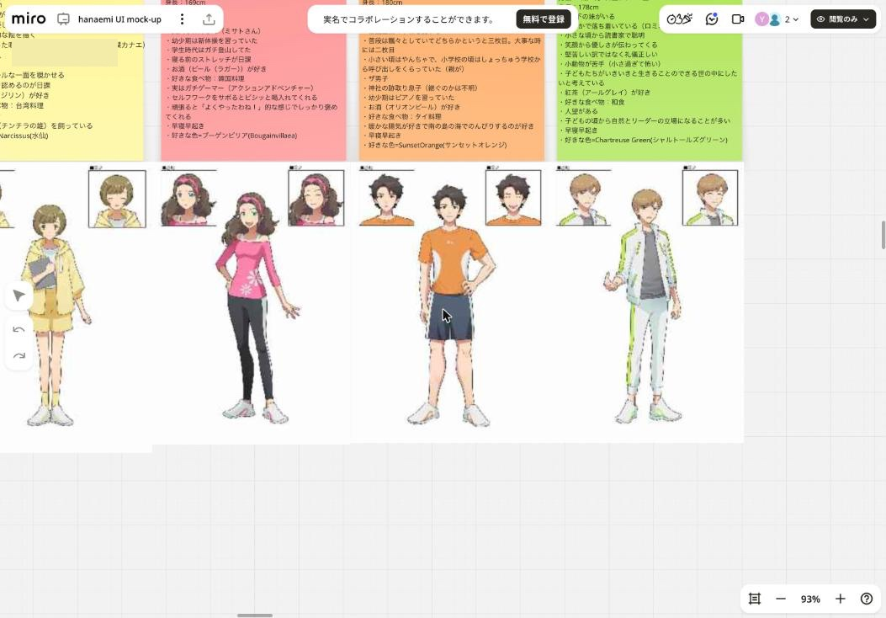
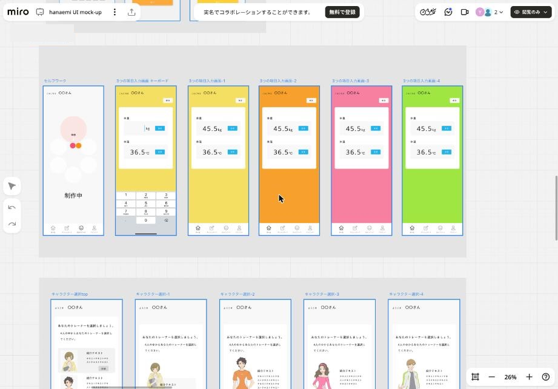

# 06. コンテンツとデザイン

## トレーナー（キャラクター）

| 名前 | 性別・年齢 | 人物像 | 好きな色 |
|---|---|---|---|
| **フローラ** | 女性 23歳（10/17生、O型、160cm） | 朗らかで優しい癒し系の美人。おっとりした喋り方だが芯は強く、たまにクールな一面も。毎朝日記を書くのが日課。紅茶（ダージリン）と台湾料理が好き | Narcissus（水仙） |
| **サザンカ** | 女性 29歳（7/14生、A型、169cm） | 明るく元気な美人のお姉さん。新体操と本格的な登山の経験あり。寝る前のストレッチが日課。実はガチゲーマー。セルフワークをサボると喝を入れ、頑張るとしっかり褒めてくれる | Bougainvillaea（ブーゲンビリア） |
| **サクヤ** | 男性 33歳（5/5生、B型、180cm） | 懐が深く優しい自由主義者。普段は飄々とした三枚目で、大事な時は二枚目。神社の跡取り息子。南の島でのんびりするのが好き | Sunset Orange |
| **ロータス** | 男性 27歳（2/4生、AB型、178cm） | 穏やかで落ち着いた読書家。礼儀正しく人望があり、自然とリーダーになるタイプ。紅茶（アールグレイ）と和食が好き | Chartreuse Green |

- 4 人とも早寝早起き
- 声優のボイスを付ける。キャラクター名とセリフの決定、声優の手配がタスクに挙がっている
- 立ち絵（全身）と表情差分（バストアップ）がボード上にある

## セルフワークのコンテンツ制作（9/13 MTG）

| 種目 | 形式 | 制作内容 |
|---|---|---|
| 瞑想 | 静止画と声優によるインストラクション | 最大 4 レッスン。呼吸なし版（5分 / 10分）と呼吸あり版（5分 / 10分）。声優と静止画は 2 パターン |
| ヨガ | 動画撮影 | 5分版と 10分版の 2 本（テスト次第で追加） |
| ワークアウト（ダンス） | 動画撮影 | Zumba 系のフィットネスダンス。講師版で 5分 / 10分 |
| ジャーナリング | 未定 | テーマを決めて、今の思いや感情を書き出す。後で見返して気づきを得る |
| 断捨離 | 未定 | |
| モーニングダイアリー | 未定 | （参考）ナイトダイアリー: 今日あった良いことを 3 つ書いて内省する |

## 配色

| 用途 | 色 | 出典 |
|---|---|---|
| Body（体） | ピンク系 | トリニティのカンプ |
| Mind（心） | オレンジ系 | トリニティのカンプ |
| Spirit（魂） | 黄色系 | トリニティのカンプ |
| ホームのヘッダー | 黄色系 | ホームのカンプ |
| セルフワーク画面 | ピンクのグラデーション（キャラクターの色に合わせる案あり） | セルフワークのカンプ |
| メインボタン（はい等） | `#ef857d` | WF の図形 |
| 確定・完了ボタン | `#58afb3` | アカウント設定の WF |
| リンク・情報ボタン | 青（`#2d9bf0` 系） | カンプ |
| 色の候補（付箋） | `#99EC4C`, `#ff9328` | 体重入力の配色違いカンプ |

- メインカラー（スタートガイドの背景色）は 8/20 の MTG で検討タスクになっている。最終決定はボード上で確認できない
- 過去のカンプには、体重入力画面を黄・オレンジ・ピンク・緑で塗り分けた配色違いがある

## ロゴ・アイコン

- ロゴ: 多色の花（ひまわり / 蓮のような曼荼羅風）と「Hanaemi」の文字
- タブのアイコン: ホーム / ダッシュボード / セルフワーク / アカウント。シンプルで分かりやすいものにする（パッケージで検討）。WF 付箋「アイコンは白」
- セルフワークのアイコンは、コンテンツが固まってから作る

## 参考 UI

- ボード上に BALANCE（瞑想アプリ）などの参考スクリーンショットが貼られている
