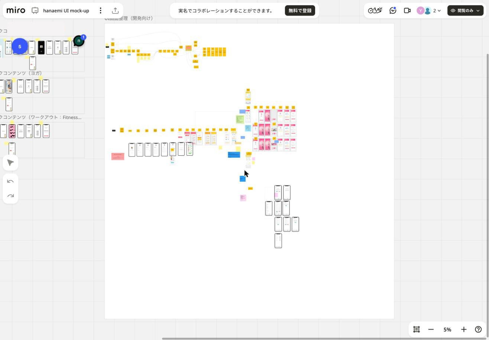

# hanaemi 実装ドキュメント

Miro ボード「hanaemi UI mock-up」の内容を、実装に必要な形に整理したドキュメント群。

- 取得日: 2026-11-10（閲覧のみ権限で取得）
- ボード規模: 1,319 要素（フレーム 88 / テキスト 389 / 図形 246 / 画像 304 / 付箋 70 / コネクタ 159 ほか）

## ドキュメント一覧

| ファイル | 内容 |
|---|---|
| [01_service-overview.md](01_service-overview.md) | サービスコンセプト、ターゲット、ペルソナ、ユーザーインタビューの要点 |
| [02_screen-flow.md](02_screen-flow.md) | 画面遷移（最新の開発向けフロー、初期案フロー、サイトマップ） |
| [03_screens.md](03_screens.md) | 画面一覧と各画面の構成要素 |
| [04_features.md](04_features.md) | 機能仕様（認証、トリニティ診断、今日の状態、記録、グラフ、セルフワーク、設定、アラームほか） |
| [05_data-model.md](05_data-model.md) | 画面と仕様から推定したデータモデル案 |
| [06_contents-and-design.md](06_contents-and-design.md) | トレーナー（キャラクター）設定、セルフワークのコンテンツ、配色、サウンド |
| [07_open-issues.md](07_open-issues.md) | 仕様の矛盾、未決事項、エンジニアへの確認事項 |
| [08_meeting-notes.md](08_meeting-notes.md) | ボードに残っている MTG メモの整理 |
| [09_tech-options.md](09_tech-options.md) | 技術選定の選択肢（クライアント、バックエンド、配信、課金など）と構成案 |
| [images/](images/) | ボードのスクリーンショット |

## ボードの読み方（重要）

ボードには複数の時期の案が混在している。**実装の正は「UI画面整理（開発向け）」フレーム**とし、それ以外は経緯や参考として扱う。

| エリア | 位置づけ |
|---|---|
| UI画面整理（開発向け） | **最新・開発向け**。画面フロー（黄色の箱）とデザインカンプが対応付けて並んでいる |
| 画面遷移フロー / 会員登録・ログイン画面 / 登録画面 / ホーム系ワイヤー | 初期のワイヤーフレーム。命名や項目が最新版と異なる箇所がある |
| セルフワークコンテンツ（瞑想 / ヨガ / ワークアウト） | セルフワーク実行フローのワイヤー。開発向けカンプの元になったもの |
| マインドマップ（ボード最上部） | 初期のサイトマップ |
| 大きな画像群（ボード左下） | デザインカンプの過去バージョン（配色違い、トレーナー選択の別案など） |
| サービス概要 / ユーザーインタビュー / 機能ディスカッション | 企画資料 |
| 8/20, 9/6, 9/13 の MTG フレーム | 議事メモ（2021 年と推定） |

